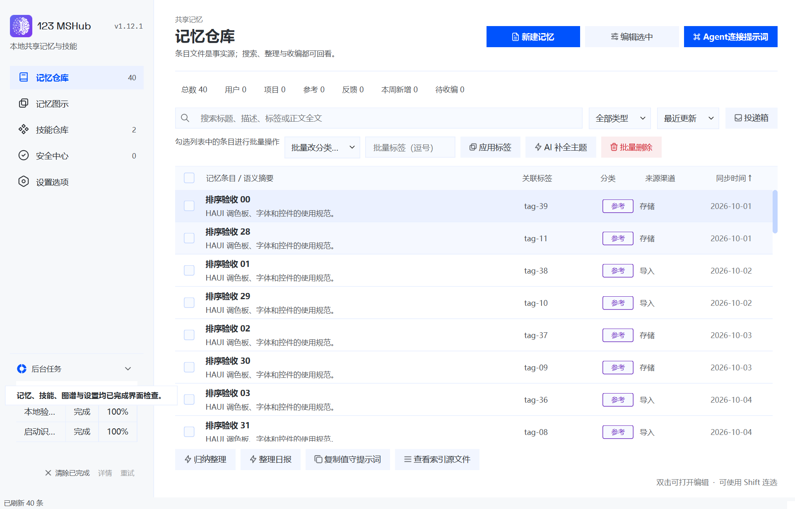
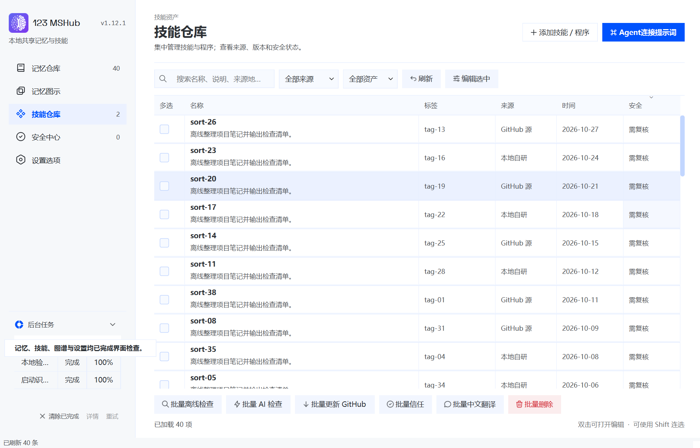

# v1.12.1 验收报告

日期：2026-11-03。基线 v1.12.0（16956f8）。此次补丁只扩展列表排序交互并修复原生启动对技能目录识别的遗漏，沿用 HAUI 界面与仓库格式。

## 结果

| 验证层 | 结果 | 证据 |
| --- | --- | --- |
| 全量 Python 回归 | 347 通过，0 失败、0 跳过；69.91 秒 | [JUnit](v1.12.1/python-tests.xml) |
| 新增回归 | 17 项，覆盖所有目标列、升降序、滚动首项、批量勾选、草稿、待返回读取、空列表、语言、保存定位、启动恢复与失败重试 | [测试代码](../../tests/native/test_v1121_lists_sync.py) |
| 实际 Windows EXE | 125% / 150% 两次通过，各 25 张截图；frozen=true；新增长列表与启动恢复断言通过 | [125%](v1.12.1/dpi125/ui-smoke.json)、[150%](v1.12.1/dpi150/ui-smoke.json) |
| 完整包 | 239 个文件、56 个冻结模块、28 个 HAUI/图谱资源；版本、ZIP CRC、清单和逐文件哈希一致 | [包检查](v1.12.1/bundle-check.json) |
| 在线升级包兼容 | 使用与 v1.12.0 字节一致的生产升级器安全解压，校验 238 个清单文件 | [升级包检查](v1.12.1/upgrade-package-check.json) |
| Microsoft Defender | 目录及最终 ZIP 扫描退出码 0，无威胁，实时保护启用；PE FileVersion/ProductVersion 均为 1.12.1 | [扫描报告](v1.12.1/defender-scan.json) |
| 凭据 | 提供的 GitHub 凭据未出现在 729 个受检源码、文档和包内文件中 | [检查摘要](v1.12.1/credential-check.json) |
| 网络监听 | UI 测试期间抽样观察当前程序及子进程，未发现 TCP 监听 | [进程检查](v1.12.1/exe-ui-checks.json) |

全量测试有两条现存的 Starlette/AnyIO 弃用警告，没有失败；依赖未变更，`uv lock --check` 通过。构建另增加 EXE 版本资源校验，防止 Python 与 Windows 文件属性版本不一致。

## 同步问题的查验结论

旧启动链 `MainWindow.startup → MemoryFacade.heal → MemoryService.heal` 仅处理记忆。技能列表读取只在数据库为空时恢复同步目录，已有数据库的机器可能因此漏掉新技能。这已在隔离仓库复现：原启动 heal 后仍只有旧条目，新版真实启动后台任务完成后技能和安全列表均出现新条目。

v1.12.1 每次启动通过已有串行任务队列执行一次完整识别，与手动“重新识别已同步条目”相同，完成时刷新所有页面。启动后才落盘的新文件仍需手动识别或下一次启动；没有增加常驻监视。设置里的自动同步来源用于外部记忆导入，与技能目录识别不同。

## 界面证据

## 交付与验证边界

标准 onedir 完整包，关闭 UPX，无混淆、管理员提权要求或杀毒排除；未签名。测试使用本机合成隔离仓库和 Qt DPR 设置，没有修改日常 MSH 仓库。真实同步盘客户端、第二台电脑、外部 AI 提供方、SmartScreen 和其他杀毒软件未做本轮验证；没有替换当前正在日常使用的程序目录。

ZIP 大小 164800268 字节，SHA-256 `24ec05d4045be81de810ce1614d09aa934e3b6be615ecfef4df4d340f6742514`。完整结构化证据见 [acceptance-v1.12.1.json](v1.12.1/acceptance-v1.12.1.json)。GitHub 源码、标签、资产和公开下载在发布后再次核对，结果保存在本地 `release/native-v1.12.1/github-publication.json`；匿名生产更新查询保存在同目录 `online-update-check.json`。
